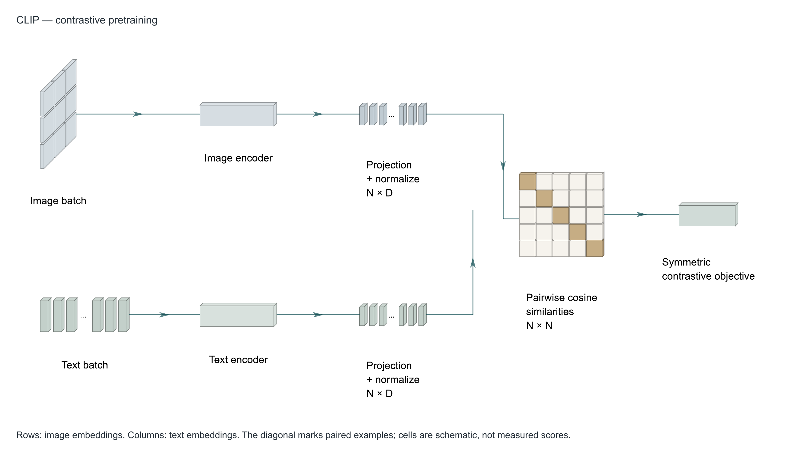

# Engineering Model Diagrams



[中文](README.md) · [Source-backed gallery](docs/gallery.md) · [Five scientific palettes](docs/palettes.md) · [Releases](https://github.com/Hhh101-Bao/engineering-model-diagrams/releases/latest)

A Codex skill and deterministic drawing toolkit for evidence-led architecture figures. The host assistant reads papers, model images or code, constructs an evidence-backed graph, generates layout/code, compiles genuine feature volumes and reviews the rendered result. Users do not need to supply JSON or coordinates. Standalone CLI use still requires a model description or a gallery entry; the local scripts do not contain a language model.

Version0.5 uses semantic geometry for spatial tensors, patch/window partitions, token sequences, gating and similarity matrices. Architecture-specific compositions preserve the distinguishing structure of each model. Figures use restrained technical captions and matte geometry. Repeated cells are schematic samples; annotated tensor dimensions remain authoritative. CLIP's diagonal indicates paired examples, not measured scores.

The library includes14 model schematics and14 module/subnetwork schematics across vision backbones, segmentation, detection, remote sensing, change detection and vision-language learning. Every entry links its primary paper or author implementation and states its variant and abstraction scope. These are our source-backed redraws, not official author figures or executable implementations of the networks.

## Install

Use the Windows x64 portable release, or clone the repository and install Node.js20+, Python+pypdf, Typst>=0.14 and Poppler. The source repository omits the large compiler binary. The Windows helper downloads and verifies the pinned official Typst archive.

```bash
python -m pip install -r requirements.txt
python scripts/setup-typst.py   # Windows x64 only; skip if Typst is already on PATH
python scripts/install-skill.py
```

Attach a paper and ask: “Use $engineering-model-diagrams to understand this model, generate a source-backed volume diagram with clear gaps and surface-connected arrows, review the actual output, and deliver editable sources, vectors and a genuine3D model.”

```bash
node skills/engineering-model-diagrams/scripts/render-catalog.mjs --list
node skills/engineering-model-diagrams/scripts/render-catalog.mjs --model unetformer --theme sage-earth --out output/unetformer
```

Choose `steel-teal`, `ocean-sand`, `sage-earth`, `plum-slate` or `graphite-amber`. Outputs include Typst with portable source dependencies, vector PDF/SVG, PNG, GLB meshes and an offline3D viewer. Volumes have noncoplanar XYZ vertices and triangle faces, with no model-image textures.

Diagrams preserve uncertainty instead of inventing unknown dimensions or operator internals. Dense figures may require overview/detail decomposition for a narrower journal column. Automated file checks do not prove semantic correctness or replace visual inspection. Original U-Net valid-padding dimensions and the pinned STANet paper/code differences are explicitly documented in the gallery.

Original project code and figures: [MIT](LICENSE). Dependencies retain their licenses; see [third-party notices](THIRD_PARTY_NOTICES.md). Built with the actual PlotNeuralNet/neural-netz volume primitives, CeTZ, Typst and ELK. No full third-party papers or original author figures are redistributed.
