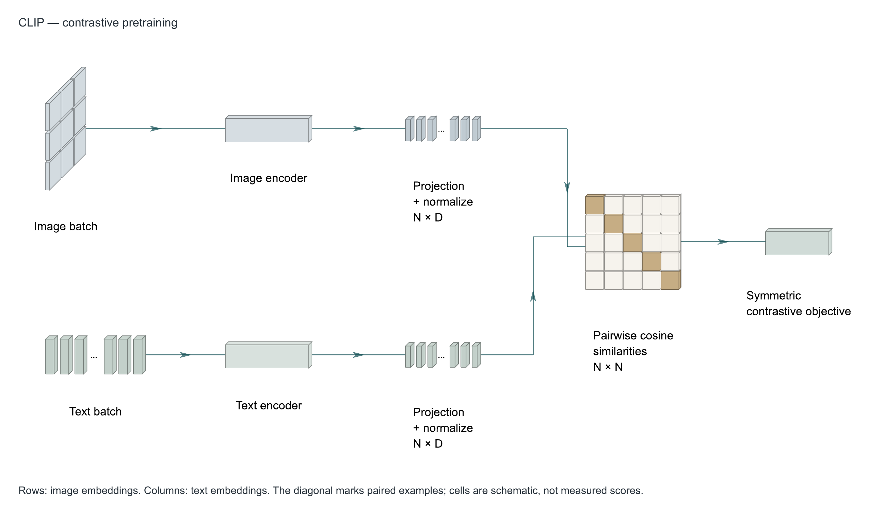
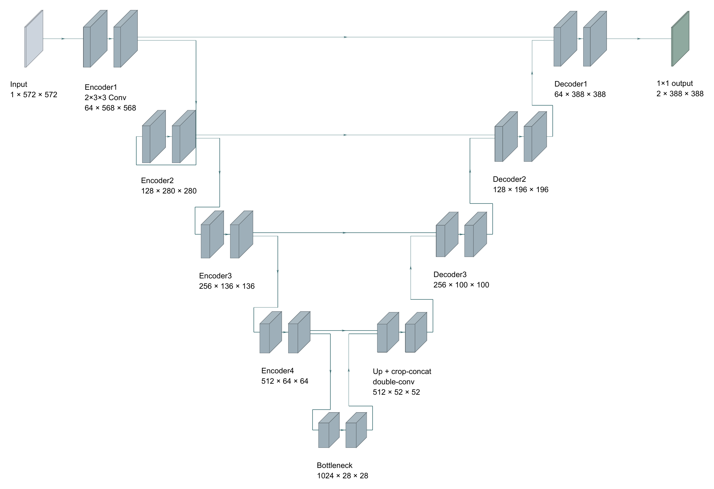
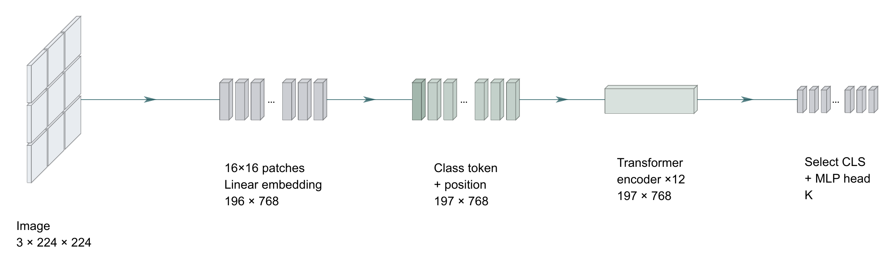
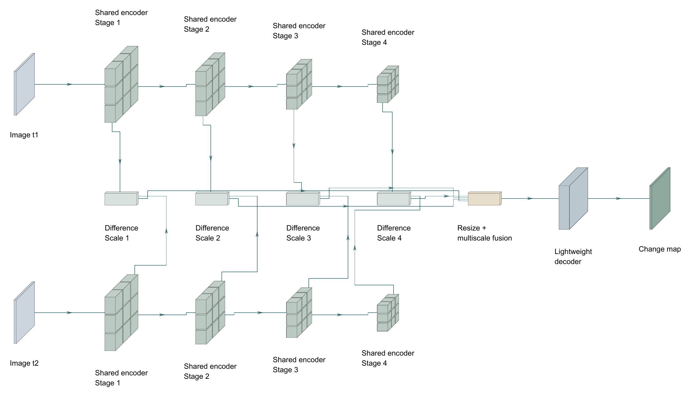
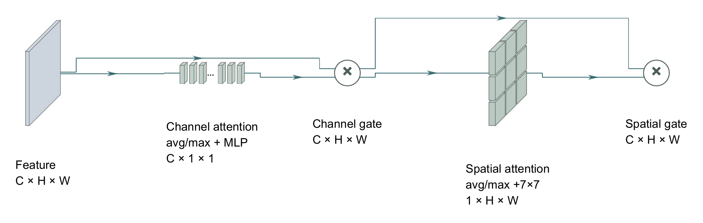
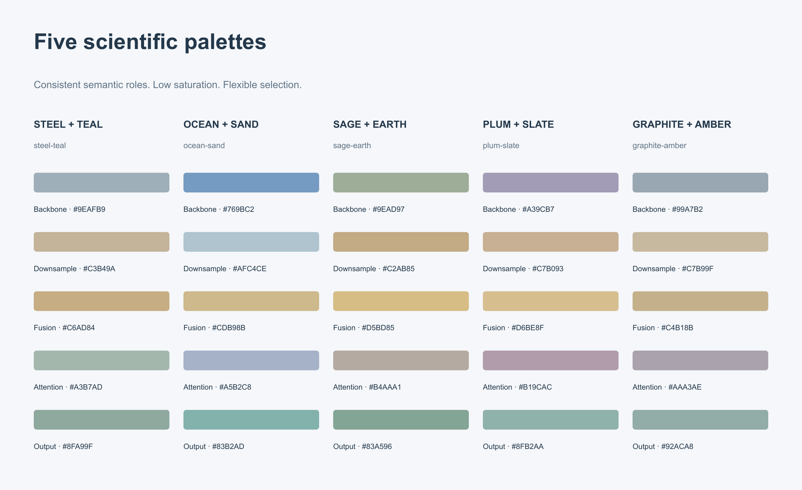

# Engineering Model Diagrams

**从论文、模型图和代码，生成有出处、可编辑的科研立体网络图。**

[English](README.en.md) · [分类图库](docs/gallery.md) · [五套科研配色](docs/palettes.md) · [下载 Releases](https://github.com/Hhh101-Bao/engineering-model-diagrams/releases/latest) · [安装与使用](docs/installation.md)



空间特征、token、窗口、门控与矩阵各用其适合的表达。v0.5按模型结构组织构图，收敛字体、线条与颜色，移除产品海报式封面和渐变算子。重复图形是示意采样，真实数量以维度标注为准；详见[表达规则](skills/engineering-model-diagrams/references/visual-language.md)。

这是一套可安装的 **Codex Skill + 绘图工具**。调用 Skill 的助手阅读材料、解释模型并生成中间结构，脚本执行布局、代码生成和真实编译。用户无需先写 JSON 或坐标。离开助手单独运行 CLI 时，须提供结构描述或选择图库条目。

## 从材料到图

| 步骤 | 结果 |
|---|---|
| 阅读论文/模型图/代码 | 对照方法、公式、图注和实现，确定模型变体与范围 |
| 拆解与核对 | 模块、连接、张量尺寸；逐项记录来源和未知信息 |
| 布局与代码 | 新拓扑自动布局，独立体积、分离子层、表面端口与清晰走线 |
| 编译与审查 | 查看真实 PNG，并核对物理字号、间距、连接和结构 |
| 交付 | Typst源码及依赖、PDF/SVG/PNG、真实三维GLB、离线三维查看器、出处表 |

论文图采用三维张量的轴测矢量投影。GLB 则含实际 XYZ 顶点与三角面；不使用模型截图或图片贴图来伪装三维。未知维度与抽象算子保持明确标注。体积失败时不会静默退回平面卡片。

## 分类模型库

当前收录 **14个模型结构示意 + 14个模块/子网络示意**，另有 **5套同结构配色预览**。每个条目都能重新渲染，附原论文或作者代码、版本范围及省略说明。它们是有来源的重绘，**不是作者官方出图**。

| 大类 | 已收录模型 |
|---|---|
| 计算机视觉骨干 | ResNet-18、MobileNetV2、ViT-B/16、Swin-T |
| 视觉分割与基础模型 | 原版U-Net、DeepLabv3+、SegFormer-B0、SAM |
| 目标检测 | DETR |
| 遥感语义分割 | UNetFormer |
| 遥感变化检测 | BIT、ChangeFormer、STANet |
| 视觉语言 | CLIP |

模块包括残差块、倒残差、ViT编码块、Swin窗口块、ASPP、All-MLP解码器、SE、CBAM、全局局部注意力、语义tokenizer、孪生差分、特征细化、PAM及STANet特征提取器。详细范围见[分类图库](docs/gallery.md)。

机制细节示例：[Swin普通窗口与移位窗口双面板](docs/details/README.md)，展开预归一化、注意力、MLP及四条残差，并保留两块之间的特征连续关系。

<table>
  <tr><th>U-Net · 尺度与跳连</th><th>ViT · patch与token</th></tr>
  <tr><td></td><td></td></tr>
  <tr><th>ChangeFormer · 双时相多尺度</th><th>CBAM · 通道与空间门控</th></tr>
  <tr><td></td><td></td></tr>
</table>

## 五套科研配色

白底、深色文字、低饱和语义色；同类算子保持一致。自然语言、IR和CLI均可选主题。

| theme | 配色 | 主要色 |
|---|---|---|
| `steel-teal` | 钢蓝青绿，默认 | 钢蓝 / 青绿 / 砂金 |
| `ocean-sand` | 海蓝砂金 | 海蓝 / 浅灰蓝 / 砂金 |
| `sage-earth` | 鼠尾草大地 | 灰绿 / 土棕 / 米金 |
| `plum-slate` | 灰紫岩蓝 | 灰紫 / 岩蓝 / 柔金 |
| `graphite-amber` | 石墨琥珀 | 石墨灰 / 琥珀 / 灰青 |

[查看五套主题的同结构实际成图](docs/palettes.md)。`publication` 是 `steel-teal` 的别名；旧 `classic` 主题保留兼容。



## 安装并开始

下载 [Windows Skill包](https://github.com/Hhh101-Bao/engineering-model-diagrams/releases/latest) 后，将其中的engineering-model-diagrams目录放入Codex的skills目录。需要图库和开发脚本时克隆源码；以下命令用于源码安装。源码仓库不提交大型编译器，Windows Skill包包含固定版本Typst，其他依赖与平台说明见[安装文档](docs/installation.md)。

```bash
git clone https://github.com/Hhh101-Bao/engineering-model-diagrams.git
cd engineering-model-diagrams
python -m pip install -r requirements.txt
# Windows源码安装可选：下载并校验官方Typst；已安装Typst可跳过
python scripts/setup-typst.py
python scripts/install-skill.py
```

新一轮助手对话中附上材料，然后发送：

> 使用 `$engineering-model-diagrams`，自动理解这篇论文的模型，使用钢蓝青绿主题绘制立体网络图。保留分支、跳连、融合方式和尺寸；子层明确分离，连线接到真实表面，检查实际成图。交付矢量图、可编辑源码、三维模型和出处表，未知信息明确标注。

也可直接渲染一个有来源的模型条目：

```bash
node skills/engineering-model-diagrams/scripts/render-catalog.mjs --list
node skills/engineering-model-diagrams/scripts/render-catalog.mjs --model unetformer --theme sage-earth --out output/unetformer
```

## 质量与复现

采用 PlotNeuralNet / neural-netz 的真实体积图元，借鉴其尺度标注、连续卷积与跳连表达。额外提供分离式子层、语义主题、来源记录、GLB几何与审查记录。主页和图库均由实际后端渲染，可通过 `scripts/build-showcase.mjs` 与 `scripts/build-catalog.mjs` 重建。

细节标准包括：投影一致、独立操作留空隙、端口接到实体、箭头不堆在折角、标签不重叠、按目标成图尺寸核对字号和留白。文件检查结果见[导出审计](docs/gallery/export-audit.json)；自动检查不能代替阅读来源和看实际图。

必须说明的边界：图库多为阶段/模块级重绘，不是训练代码；宏观分组和示意比例逐项声明。原版U-Net采用valid-padding，不能与same-padding变体混称。STANet标注固定官方代码版本及论文差异。复杂宽幅图需要重新拆图才能适配较窄期刊栏宽。助手不能保证任意含糊论文均被一次正确理解。

## 来源与许可

感谢 [PlotNeuralNet](https://github.com/HarisIqbal88/PlotNeuralNet)、[neural-netz](https://github.com/edgaremy/neural-netz)、[CeTZ](https://github.com/cetz-package/cetz)、[Typst](https://github.com/typst/typst) 与 [ELK](https://github.com/kieler/elkjs)。项目自有部分采用 [MIT](LICENSE)；第三方组件保留各自许可，详见 [THIRD_PARTY_NOTICES](THIRD_PARTY_NOTICES.md)。原始第三方论文和作者示例图片不随发行包重新分发。
