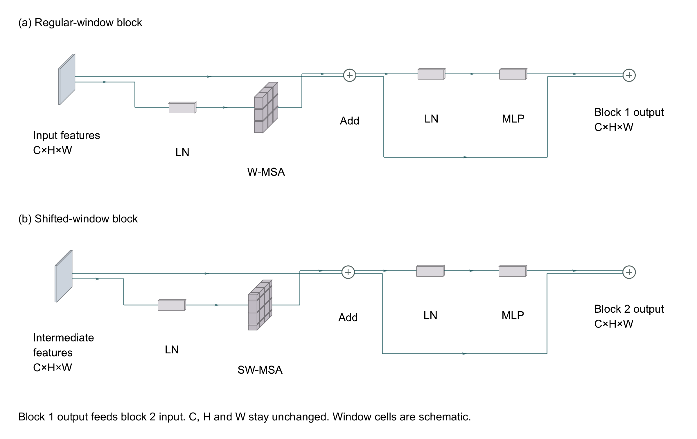

# Swin 连续模块机制图

依据[原论文](https://arxiv.org/abs/2103.14030) Fig.3b、Eq.3和§3.2重绘。两块分别保留预归一化、注意力、MLP和各自的两条残差连接；第一块输出是第二块输入。窗口单元是示意采样，不代表真实窗口数量。此图经过独立使用Skill的前向检验，不是作者官方插图。

[PDF](swin-blocks-final.pdf) · [SVG](swin-blocks-final.svg) · [排版源码](swin-blocks-final.typ)

| 面板 | 结构与来源 | 体积配置 | 三维模型 | 可编辑源码 |
|---|---|---|---|---|
| 普通窗口 | [IR](regular-block-final.ir.json) | [JSON](regular-block-final.volume.json) | [GLB](regular-block-final.glb) | [Typst](regular-block-final.typ) |
| 移位窗口 | [IR](shifted-block-final.ir.json) | [JSON](shifted-block-final.volume.json) | [GLB](shifted-block-final.glb) | [Typst](shifted-block-final.typ) |

最终合页190×119.659mm，实际最小字号8.5pt；中间算子省略反复出现的尺寸，但IR和tensor数据保留。源码与同名.assets目录一同移动。根目录执行`node scripts/build-details.mjs`重建。

完整横向长链需360mm宽；完整纵向稿过高。60mm纵向细节在8.5pt时也超过140mm高度限制，因此选用分面板稿，没有通过压小字号处理。浏览器三维交互未做实测。
