# 分类模型与模块图库

下图均是依据原论文或作者代码重新绘制的结构示意，不是作者官方出图。优先表达有出处的模块、连接与尺度；省略内容、具体变体和示意比例逐项说明。展示图不代表已运行对应模型训练或验证精度。

空间特征、token、窗口、门控和矩阵采用不同的语义几何。重复的token、网格和矩阵单元是示意采样，真实数量以维度标注为准。CLIP矩阵对角线表示配对位置，不表示测得的相似度值。

[返回主页](../README.md) · [五套科研配色](palettes.md)

渲染任一条目：

```text
node skills/engineering-model-diagrams/scripts/render-catalog.mjs --model MODEL_ID --theme steel-teal --out output/model
```

## 计算机视觉 · 骨干与分类

### ResNet-18

ID: `resnet18` · 8模块 / 7连接 · 成图宽246.043mm

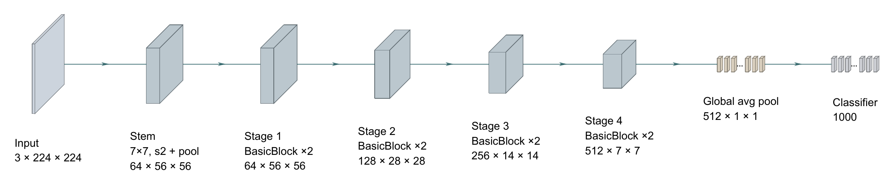

[PDF](gallery/resnet18.pdf) · [SVG](gallery/resnet18.svg) · [三维GLB](gallery/resnet18.glb) · [离线三维](gallery/resnet18.3d.html) · [结构JSON](gallery/resnet18.ir.json) · [体积配置](gallery/resnet18.volume.json)

依据：[原论文或作者代码](https://arxiv.org/abs/1512.03385)，Table 1; BasicBlock in torchvision/models/resnet.py。

范围：224×224 input, four stages of two BasicBlocks; stage outputs shown. Stem includes Conv/BN/ReLU/MaxPool. Block internals are expanded separately.

### MobileNetV2 1.0

ID: `mobilenetv2` · 11模块 / 10连接 · 成图宽280.028mm

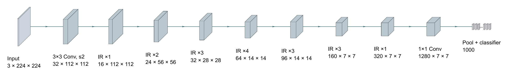

[PDF](gallery/mobilenetv2.pdf) · [SVG](gallery/mobilenetv2.svg) · [三维GLB](gallery/mobilenetv2.glb) · [离线三维](gallery/mobilenetv2.3d.html) · [结构JSON](gallery/mobilenetv2.ir.json) · [体积配置](gallery/mobilenetv2.volume.json)

依据：[原论文或作者代码](https://arxiv.org/abs/1801.04381)，Table 2; torchvision MobileNetV2 default inverted_residual_setting。

范围：224 input and width multiplier1.0. Each stage groups repeated inverted residual blocks; internal expansion and depthwise steps have their own module diagram.

### ViT-B/16

ID: `vit-b16` · 5模块 / 4连接 · 成图宽219.817mm

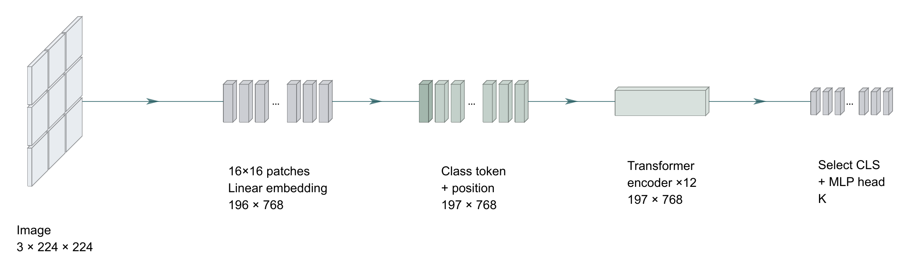

[PDF](gallery/vit-b16.pdf) · [SVG](gallery/vit-b16.svg) · [三维GLB](gallery/vit-b16.glb) · [离线三维](gallery/vit-b16.3d.html) · [结构JSON](gallery/vit-b16.ir.json) · [体积配置](gallery/vit-b16.volume.json)

依据：[原论文或作者代码](https://arxiv.org/abs/2010.11929)，Fig.1; §3.1; Table1。

范围：224 input,16-pixel patches:196 patch tokens plus one class token.12 encoder blocks with D768. Positional embedding and class-token insertion grouped explicitly; token axes are not image spatial dimensions.

### Swin-T

ID: `swin-t` · 10模块 / 9连接 · 成图宽280.172mm

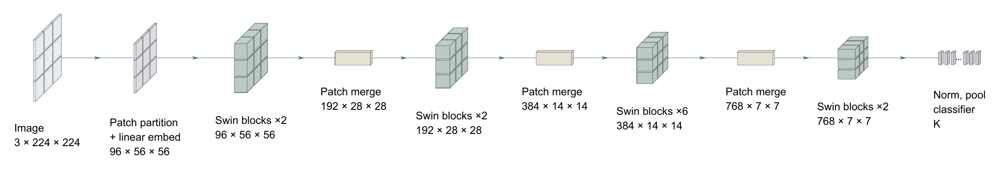

[PDF](gallery/swin-t.pdf) · [SVG](gallery/swin-t.svg) · [三维GLB](gallery/swin-t.glb) · [离线三维](gallery/swin-t.3d.html) · [结构JSON](gallery/swin-t.ir.json) · [体积配置](gallery/swin-t.volume.json)

依据：[原论文或作者代码](https://arxiv.org/abs/2103.14030)，Fig.3; Microsoft configs/swin/swin_tiny_patch4_window7_224.yaml。

范围：224 input,patch4,window7,stage depths2/2/6/2. Patch merging is a distinct operation. Layer norms and final pooling/classifier are grouped.

## 计算机视觉 · 分割与基础模型

### U-Net · original valid-padding

ID: `unet-original` · 11模块 / 14连接 · 成图宽280.027mm

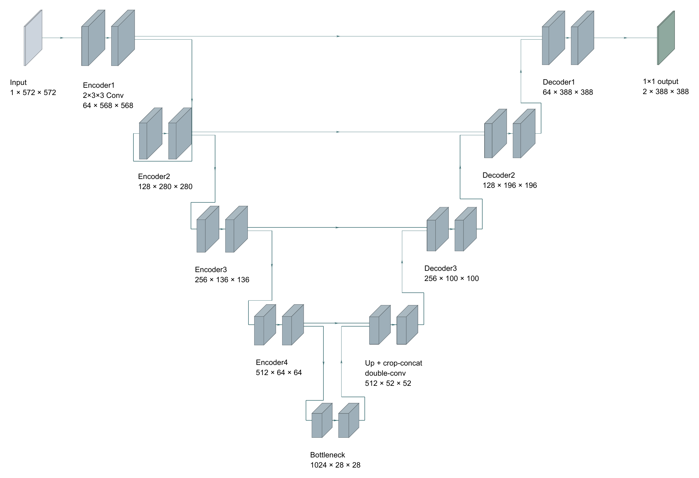

[PDF](gallery/unet-original.pdf) · [SVG](gallery/unet-original.svg) · [三维GLB](gallery/unet-original.glb) · [离线三维](gallery/unet-original.3d.html) · [结构JSON](gallery/unet-original.ir.json) · [体积配置](gallery/unet-original.volume.json)

依据：[原论文或作者代码](https://arxiv.org/abs/1505.04597)，Fig.1; §2。

范围：Original572 input and388 output; valid3×3 convolutions. Each encoder stage includes the following pooling operation only on outgoing main paths; skip edges include crop. Decoder stages group up-conv, crop-concat and double-conv.

### DeepLabv3+

ID: `deeplabv3plus` · 8模块 / 8连接 · 成图宽218.053mm

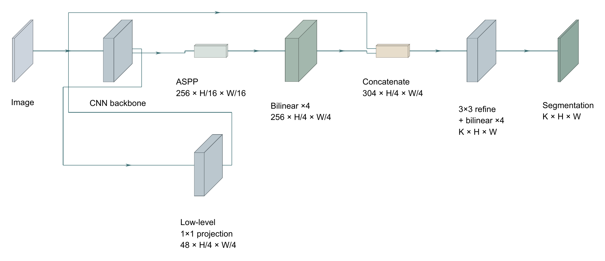

[PDF](gallery/deeplabv3plus.pdf) · [SVG](gallery/deeplabv3plus.svg) · [三维GLB](gallery/deeplabv3plus.glb) · [离线三维](gallery/deeplabv3plus.3d.html) · [结构JSON](gallery/deeplabv3plus.ir.json) · [体积配置](gallery/deeplabv3plus.volume.json)

依据：[原论文或作者代码](https://arxiv.org/abs/1802.02611)，Fig.2; §3.2。

范围：Output stride16 schematic. ASPP internals have a separate module view. Low-level features are projected to48 channels; encoder features are upsampled4× before concat, then refined and upsampled4×.

### SegFormer-B0

ID: `segformer-b0` · 12模块 / 14连接 · 成图宽260.027mm

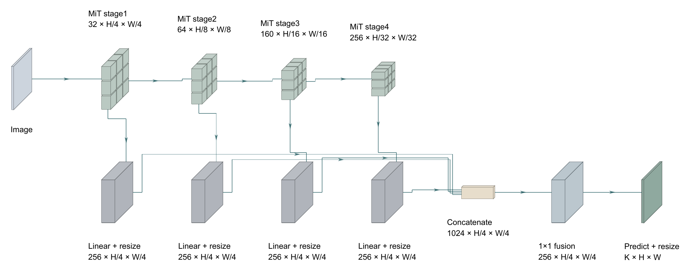

[PDF](gallery/segformer-b0.pdf) · [SVG](gallery/segformer-b0.svg) · [三维GLB](gallery/segformer-b0.glb) · [离线三维](gallery/segformer-b0.3d.html) · [结构JSON](gallery/segformer-b0.ir.json) · [体积配置](gallery/segformer-b0.volume.json)

依据：[原论文或作者代码](https://github.com/NVlabs/SegFormer/blob/master/mmseg/models/decode_heads/segformer_head.py)，SegFormerHead.forward; official B0 config。

范围：Four MiT-B0 output levels32/64/160/256. Each decoder projection maps to256 and resizes to1/4. Fusion concat is1024 channels before1×1 fusion and prediction. Final resize shown; encoder internals omitted.

### Segment Anything · SAM

ID: `sam` · 7模块 / 6连接 · 成图宽240mm

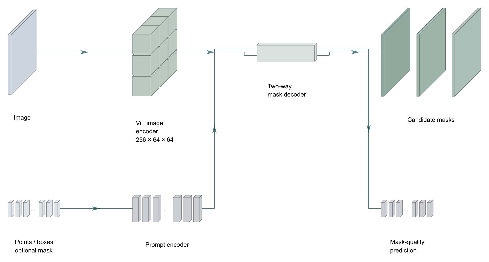

[PDF](gallery/sam.pdf) · [SVG](gallery/sam.svg) · [三维GLB](gallery/sam.glb) · [离线三维](gallery/sam.3d.html) · [结构JSON](gallery/sam.ir.json) · [体积配置](gallery/sam.volume.json)

依据：[原论文或作者代码](https://arxiv.org/abs/2304.02643)，Fig.4; AppendixA; official segment_anything/modeling。

范围：SAM1 inference macro view: image encoder, sparse/dense prompt encoder, mask decoder, mask outputs and quality scores. Prompt types are grouped; automatic mask generation is not an extra neural stage.

## 计算机视觉 · 目标检测

### DETR

ID: `detr` · 7模块 / 6连接 · 成图宽239.999mm

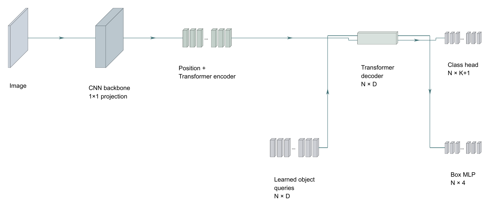

[PDF](gallery/detr.pdf) · [SVG](gallery/detr.svg) · [三维GLB](gallery/detr.glb) · [离线三维](gallery/detr.3d.html) · [结构JSON](gallery/detr.ir.json) · [体积配置](gallery/detr.volume.json)

依据：[原论文或作者代码](https://arxiv.org/abs/2005.12872)，Fig.2; §3。

范围：Inference architecture: CNN features+position feed encoder; learned object queries feed decoder. Class and box heads operate in parallel. Bipartite matching loss is a training objective and is omitted.

## 遥感 · 语义分割

### UNetFormer

ID: `unetformer` · 10模块 / 12连接 · 成图宽179.858mm

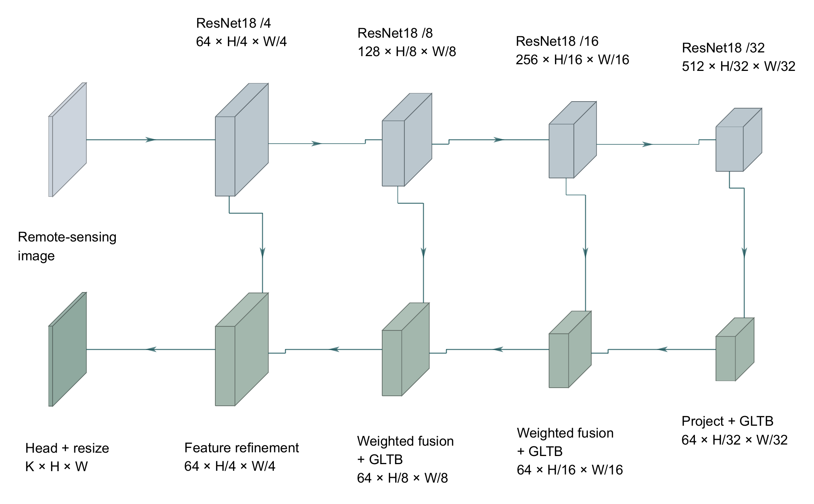

[PDF](gallery/unetformer.pdf) · [SVG](gallery/unetformer.svg) · [三维GLB](gallery/unetformer.glb) · [离线三维](gallery/unetformer.3d.html) · [结构JSON](gallery/unetformer.ir.json) · [体积配置](gallery/unetformer.volume.json)

依据：[原论文或作者代码](https://github.com/WangLibo1995/GeoSeg/blob/main/geoseg/models/UNetFormer.py)，Decoder.forward inference path; UNetFormer class。

范围：ResNet18 encoder and64-channel decoder. Three global-local blocks at1/32,1/16,1/8; weighted fusion includes upsampling. Feature-refinement head uses1/4 skip; auxiliary training head omitted.

## 遥感 · 变化检测

### BIT · bitemporal transformer

ID: `bit` · 11模块 / 13连接 · 成图宽259.87mm

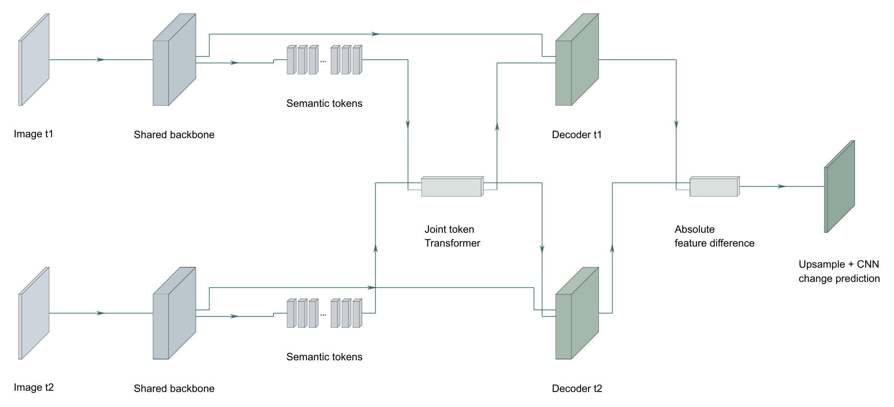

[PDF](gallery/bit.pdf) · [SVG](gallery/bit.svg) · [三维GLB](gallery/bit.glb) · [离线三维](gallery/bit.3d.html) · [结构JSON](gallery/bit.ir.json) · [体积配置](gallery/bit.volume.json)

依据：[原论文或作者代码](https://github.com/justchenhao/BIT_CD/blob/master/models/networks.py)，BASE_Transformer.forward; semantic tokenizer and transformer decoder。

范围：Shared backbone extracts both dates. Joint transformer encodes concatenated semantic tokens, which split by date for two decoder calls. Feature bypasses are preserved. Absolute differencing, upsampling and CNN classification follow.

### ChangeFormer · Siamese overview

ID: `changeformer` · 17模块 / 22连接 · 成图宽279.965mm

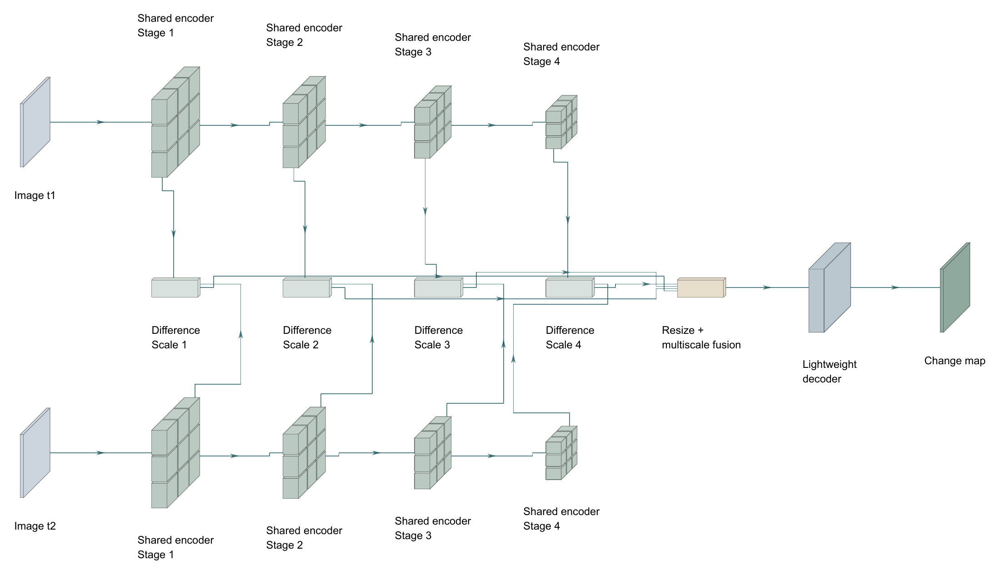

[PDF](gallery/changeformer.pdf) · [SVG](gallery/changeformer.svg) · [三维GLB](gallery/changeformer.glb) · [离线三维](gallery/changeformer.3d.html) · [结构JSON](gallery/changeformer.ir.json) · [体积配置](gallery/changeformer.volume.json)

依据：[原论文或作者代码](https://github.com/wgcban/ChangeFormer/blob/main/models/ChangeFormer.py)，Siamese Transformer encoder and multiscale decoder; §3 in IGARSS2022 paper。

范围：Macro overview shared across the family: two shared hierarchical encoders, multiscale difference modules and lightweight decoder. Exact layer counts/interpolation/upsampling differ by code variant; no numeric variant-specific dimensions are asserted.

### STANet · official-code PAM

ID: `stanet` · 12模块 / 12连接 · 成图宽320.03mm

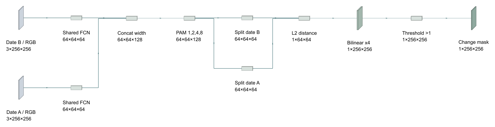

[PDF](gallery/stanet.pdf) · [SVG](gallery/stanet.svg) · [三维GLB](gallery/stanet.glb) · [离线三维](gallery/stanet.3d.html) · [结构JSON](gallery/stanet.ir.json) · [体积配置](gallery/stanet.volume.json)

依据：[原论文或作者代码](https://github.com/justchenhao/STANet/tree/6152d72f55df00a43d341580970be7a58c6b0cd5)，Pinned author code and paper doi:10.3390/rs12101662, Fig.2 and §2.1。

范围：Pinned official CDFA/mynet3/PAM code, f_c64,ds1. Code computes distance before interpolation; PAM has no residual addition, unlike the paper figure. Example256 input; training BCL omitted.

## 视觉语言

### CLIP · contrastive pretraining

ID: `clip` · 8模块 / 7连接 · 成图宽219.931mm

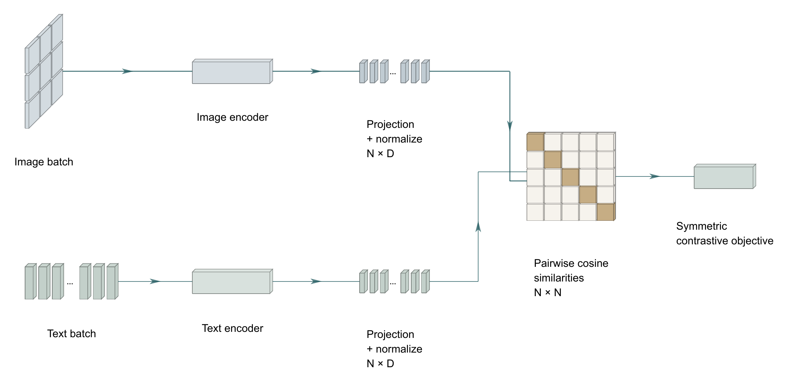

[PDF](gallery/clip.pdf) · [SVG](gallery/clip.svg) · [三维GLB](gallery/clip.glb) · [离线三维](gallery/clip.3d.html) · [结构JSON](gallery/clip.ir.json) · [体积配置](gallery/clip.volume.json)

依据：[原论文或作者代码](https://arxiv.org/abs/2103.00020)，Fig.1; §2.3。

范围：Training representation view: paired image/text encoders produce normalized embeddings and an all-pairs similarity matrix. Symmetric contrastive objective shown as a distinct endpoint; this is not a single-image segmentation pipeline.

## 模块 · 卷积与残差

### Residual BasicBlock

ID: `residual-basic` · 5模块 / 5连接 · 成图宽179.869mm

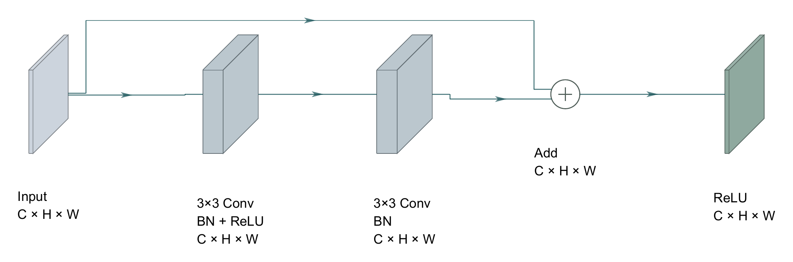

[PDF](gallery/residual-basic.pdf) · [SVG](gallery/residual-basic.svg) · [三维GLB](gallery/residual-basic.glb) · [离线三维](gallery/residual-basic.3d.html) · [结构JSON](gallery/residual-basic.ir.json) · [体积配置](gallery/residual-basic.volume.json)

依据：[原论文或作者代码](https://arxiv.org/abs/1512.03385)，Fig.2; torchvision BasicBlock.forward。

范围：Stride1, matching-channel identity path. Downsampling projection is not used in this particular block.

### Inverted residual · stride1

ID: `inverted-residual` · 5模块 / 5连接 · 成图宽179.86mm

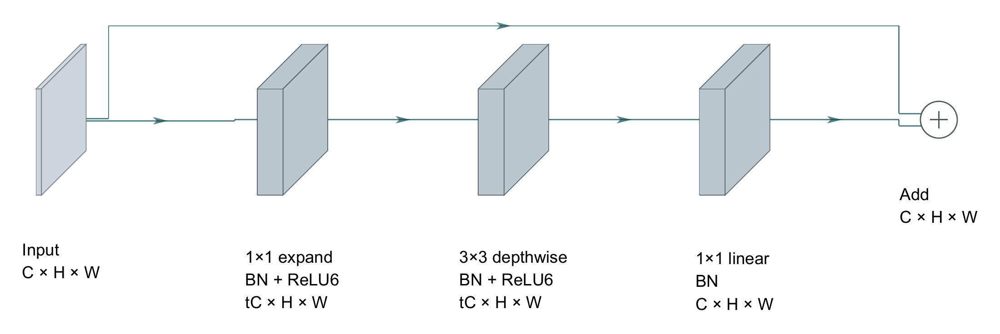

[PDF](gallery/inverted-residual.pdf) · [SVG](gallery/inverted-residual.svg) · [三维GLB](gallery/inverted-residual.glb) · [离线三维](gallery/inverted-residual.3d.html) · [结构JSON](gallery/inverted-residual.ir.json) · [体积配置](gallery/inverted-residual.volume.json)

依据：[原论文或作者代码](https://arxiv.org/abs/1801.04381)，Fig.3; Table1。

范围：Expansion factor t, depthwise spatial filtering, linear projection. Identity is shown only for stride1 and equal input/output channels.

## 模块 · Transformer

### ViT encoder block

ID: `vit-encoder` · 7模块 / 8连接 · 成图宽218.028mm

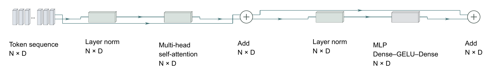

[PDF](gallery/vit-encoder.pdf) · [SVG](gallery/vit-encoder.svg) · [三维GLB](gallery/vit-encoder.glb) · [离线三维](gallery/vit-encoder.3d.html) · [结构JSON](gallery/vit-encoder.ir.json) · [体积配置](gallery/vit-encoder.volume.json)

依据：[原论文或作者代码](https://arxiv.org/abs/2010.11929)，Fig.1 right; Eqs.2–3。

范围：Pre-normalization Transformer block with two residual additions. MLP groups Dense/GELU/Dense; dropout omitted.

### Swin block pair

ID: `swin-pair` · 4模块 / 3连接 · 成图宽179.973mm

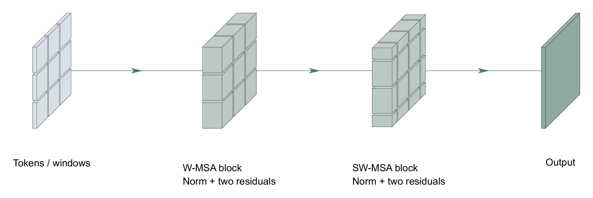

[PDF](gallery/swin-pair.pdf) · [SVG](gallery/swin-pair.svg) · [三维GLB](gallery/swin-pair.glb) · [离线三维](gallery/swin-pair.3d.html) · [结构JSON](gallery/swin-pair.ir.json) · [体积配置](gallery/swin-pair.volume.json)

依据：[原论文或作者代码](https://arxiv.org/abs/2103.14030)，Fig.3b; Eqs.3。

范围：One window-attention block followed by a shifted-window block. Each macro block includes pre-norm, attention residual and MLP residual. No patch merge inside this pair.

## 模块 · 多尺度融合

### ASPP · output stride16

ID: `aspp` · 8模块 / 11连接 · 成图宽179.948mm

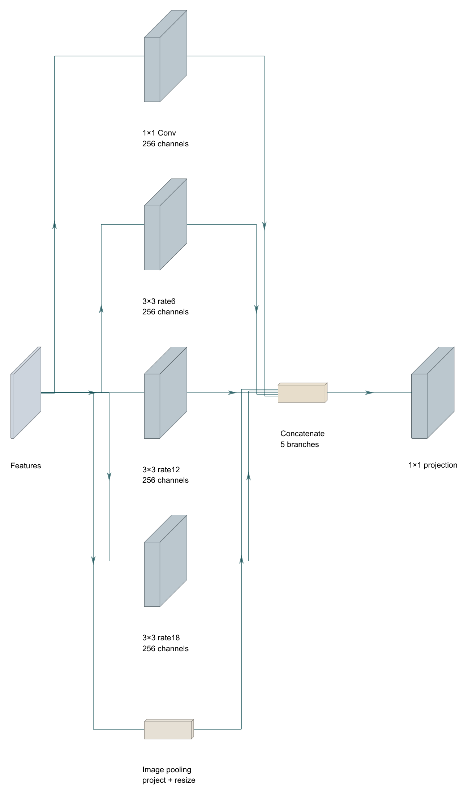

[PDF](gallery/aspp.pdf) · [SVG](gallery/aspp.svg) · [三维GLB](gallery/aspp.glb) · [离线三维](gallery/aspp.3d.html) · [结构JSON](gallery/aspp.ir.json) · [体积配置](gallery/aspp.volume.json)

依据：[原论文或作者代码](https://arxiv.org/abs/1802.02611)，Fig.2; §3.1。

范围：Five parallel branches:1×1, three atrous3×3 at rates6/12/18, image pooling with projection+resize. Concatenation followed by1×1 projection. Branch internals folded into labeled volumes.

### SegFormer All-MLP decoder

ID: `segformer-mlp` · 11模块 / 10连接 · 成图宽179.837mm

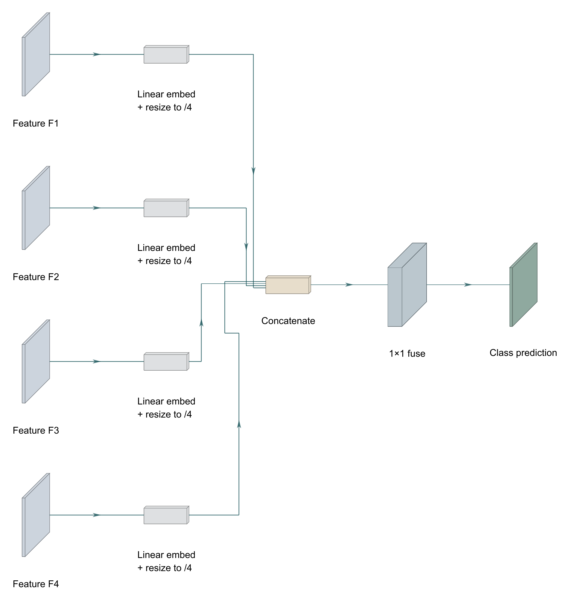

[PDF](gallery/segformer-mlp.pdf) · [SVG](gallery/segformer-mlp.svg) · [三维GLB](gallery/segformer-mlp.glb) · [离线三维](gallery/segformer-mlp.3d.html) · [结构JSON](gallery/segformer-mlp.ir.json) · [体积配置](gallery/segformer-mlp.volume.json)

依据：[原论文或作者代码](https://github.com/NVlabs/SegFormer/blob/master/mmseg/models/decode_heads/segformer_head.py)，SegFormerHead.forward。

范围：Four feature levels are linearly embedded and aligned to the finest stride. Concatenation and1×1 fusion precede class prediction. Decoder embedding width is configurable.

## 模块 · 注意力与门控

### Squeeze-and-Excitation

ID: `se` · 5模块 / 5连接 · 成图宽179.834mm

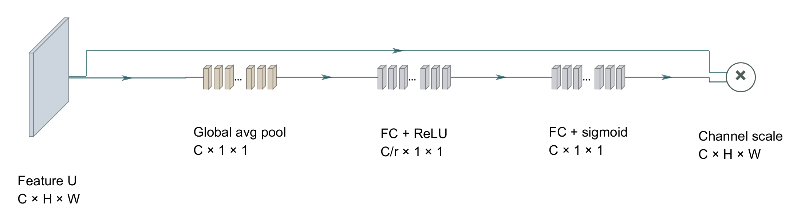

[PDF](gallery/se.pdf) · [SVG](gallery/se.svg) · [三维GLB](gallery/se.glb) · [离线三维](gallery/se.3d.html) · [结构JSON](gallery/se.ir.json) · [体积配置](gallery/se.volume.json)

依据：[原论文或作者代码](https://arxiv.org/abs/1709.01507)，Fig.1; Eqs.2–4。

范围：Global average pooling; two fully connected layers with reduction r; ReLU then sigmoid; channelwise multiplication broadcasts over H/W.

### CBAM · sequential attention

ID: `cbam` · 5模块 / 6连接 · 成图宽179.85mm

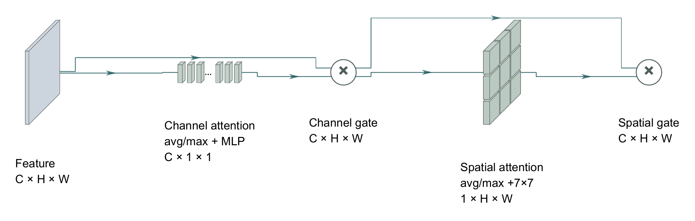

[PDF](gallery/cbam.pdf) · [SVG](gallery/cbam.svg) · [三维GLB](gallery/cbam.glb) · [离线三维](gallery/cbam.3d.html) · [结构JSON](gallery/cbam.ir.json) · [体积配置](gallery/cbam.volume.json)

依据：[原论文或作者代码](https://arxiv.org/abs/1807.06521)，Fig.1; Eqs.1–3。

范围：Channel attention followed by spatial attention; both maps gate their current features. Pool/MLP and spatial7×7 details are grouped inside the named attention modules.

## 模块 · 遥感特征交互

### UNetFormer global-local attention

ID: `global-local-attention` · 6模块 / 6连接 · 成图宽179.894mm

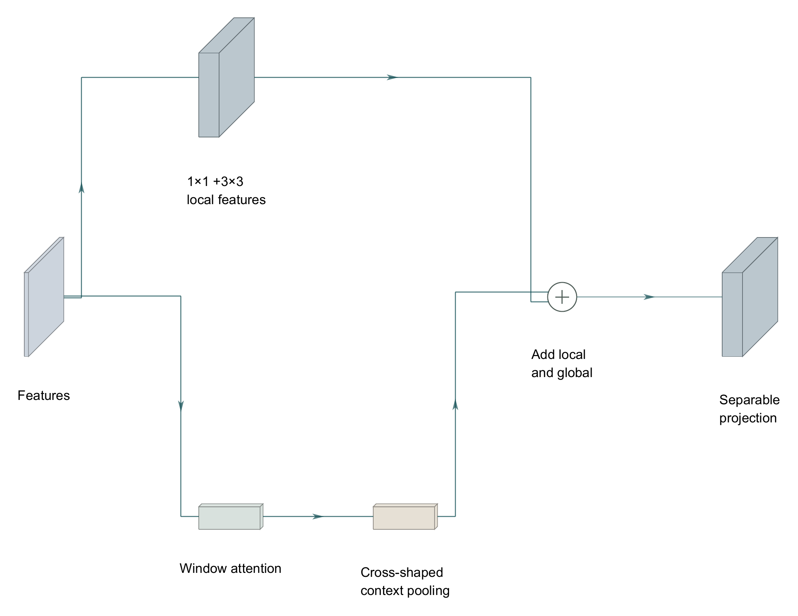

[PDF](gallery/global-local-attention.pdf) · [SVG](gallery/global-local-attention.svg) · [三维GLB](gallery/global-local-attention.glb) · [离线三维](gallery/global-local-attention.3d.html) · [结构JSON](gallery/global-local-attention.ir.json) · [体积配置](gallery/global-local-attention.volume.json)

依据：[原论文或作者代码](https://github.com/WangLibo1995/GeoSeg/blob/main/geoseg/models/UNetFormer.py)，GlobalLocalAttention.forward。

范围：Local1×1+3×3 features are added to window attention with cross-shaped pooling, then projected by separable convolution. Norm/MLP and outer GLTB residuals are outside this inner attention view.

### BIT semantic tokenizer

ID: `semantic-tokenizer` · 4模块 / 4连接 · 成图宽179.879mm

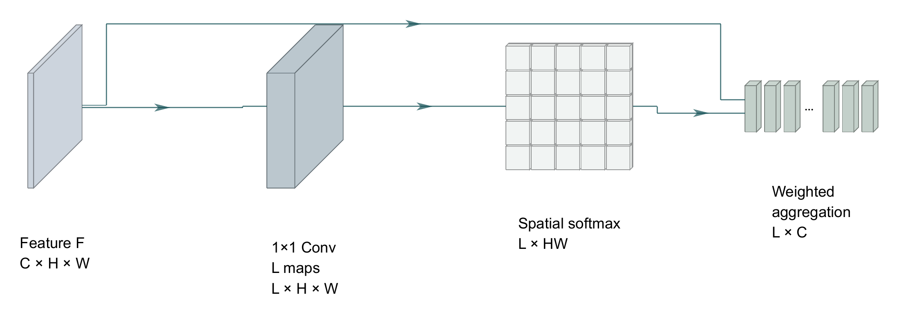

[PDF](gallery/semantic-tokenizer.pdf) · [SVG](gallery/semantic-tokenizer.svg) · [三维GLB](gallery/semantic-tokenizer.glb) · [离线三维](gallery/semantic-tokenizer.3d.html) · [结构JSON](gallery/semantic-tokenizer.ir.json) · [体积配置](gallery/semantic-tokenizer.volume.json)

依据：[原论文或作者代码](https://github.com/justchenhao/BIT_CD/blob/master/models/networks.py)，_forward_semantic_tokens。

范围：A learned1×1 projection creates L spatial attention maps; softmax is over flattened spatial positions. Weighted aggregation of the original features produces L×C tokens.

### Siamese feature differencing

ID: `siamese-difference` · 6模块 / 5连接 · 成图宽179.983mm

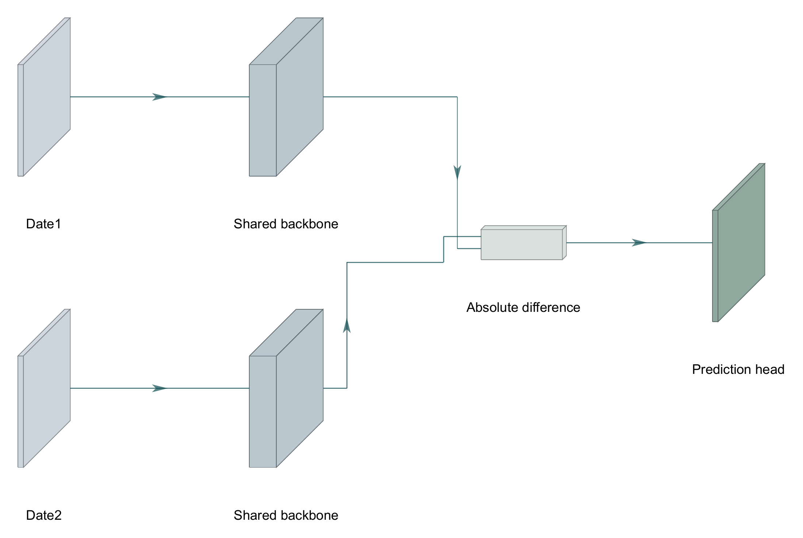

[PDF](gallery/siamese-difference.pdf) · [SVG](gallery/siamese-difference.svg) · [三维GLB](gallery/siamese-difference.glb) · [离线三维](gallery/siamese-difference.3d.html) · [结构JSON](gallery/siamese-difference.ir.json) · [体积配置](gallery/siamese-difference.volume.json)

依据：[原论文或作者代码](https://github.com/justchenhao/BIT_CD/blob/master/models/networks.py)，BASE_Transformer.forward。

范围：Shared feature extraction and absolute elementwise difference; head and interpolation details stay model-specific. Two backbone invocations share weights, not input tensors.

### UNetFormer feature-refinement head

ID: `feature-refinement` · 7模块 / 8连接 · 成图宽179.885mm

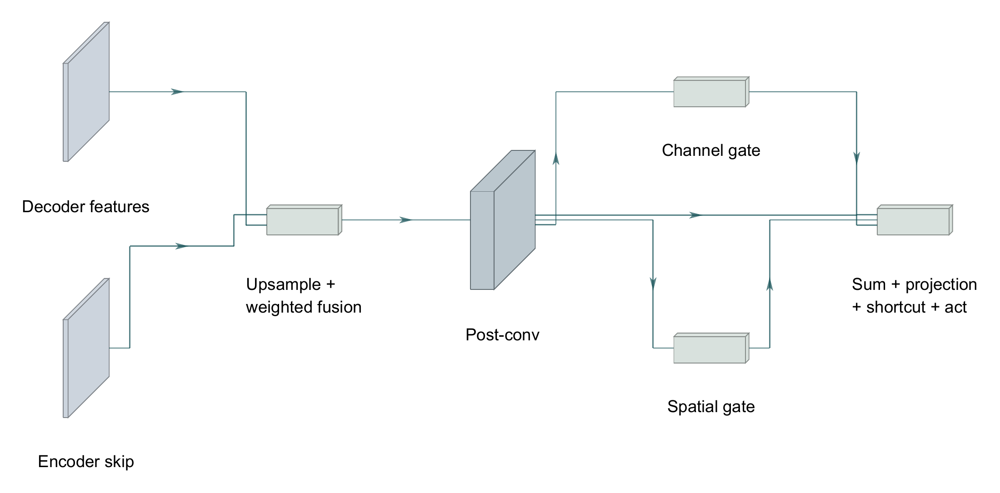

[PDF](gallery/feature-refinement.pdf) · [SVG](gallery/feature-refinement.svg) · [三维GLB](gallery/feature-refinement.glb) · [离线三维](gallery/feature-refinement.3d.html) · [结构JSON](gallery/feature-refinement.ir.json) · [体积配置](gallery/feature-refinement.volume.json)

依据：[原论文或作者代码](https://github.com/WangLibo1995/GeoSeg/blob/main/geoseg/models/UNetFormer.py)，FeatureRefinementHead.forward。

范围：Upsampling and normalized weighted skip fusion precede post-convolution. Channel/spatial attention branches gate x; their results add, project and combine with a shortcut before activation.

### STANet pyramid-attention module

ID: `stanet-pam` · 8模块 / 10连接 · 成图宽259.958mm

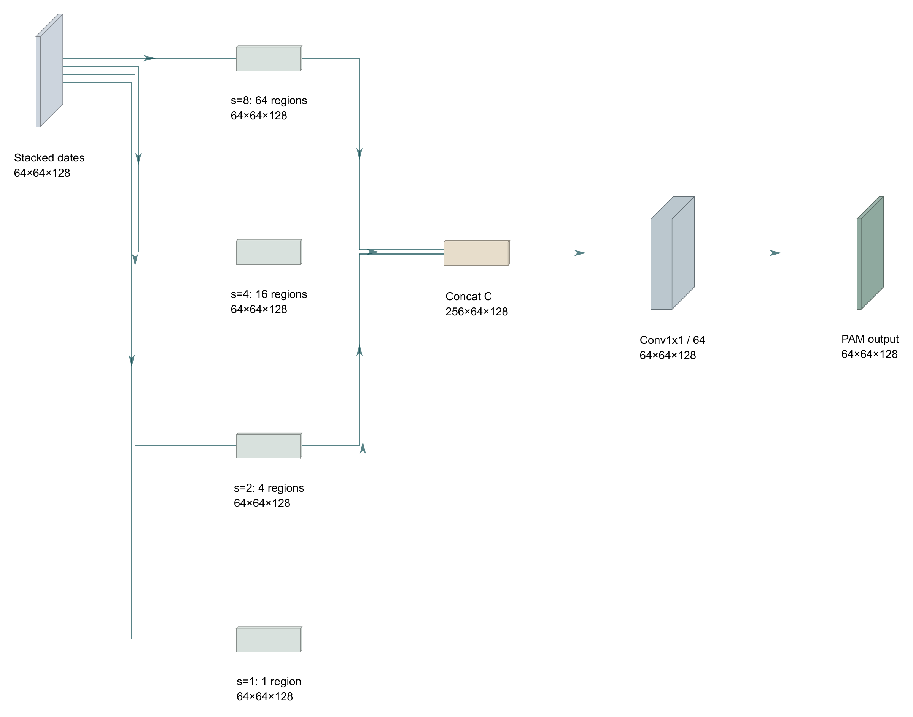

[PDF](gallery/stanet-pam.pdf) · [SVG](gallery/stanet-pam.svg) · [三维GLB](gallery/stanet-pam.glb) · [离线三维](gallery/stanet-pam.3d.html) · [结构JSON](gallery/stanet-pam.ir.json) · [体积配置](gallery/stanet-pam.volume.json)

依据：[原论文或作者代码](https://github.com/justchenhao/STANet/tree/6152d72f55df00a43d341580970be7a58c6b0cd5)，Pinned author code and paper doi:10.3390/rs12101662, Fig.2 and §2.1。

范围：Pinned PAM2.py code: four regional scales1/2/4/8, concatenation and1×1 projection. No X+Y residual in this code variant.

### STANet shared feature extractor

ID: `stanet-extractor` · 18模块 / 20连接 · 成图宽218.051mm

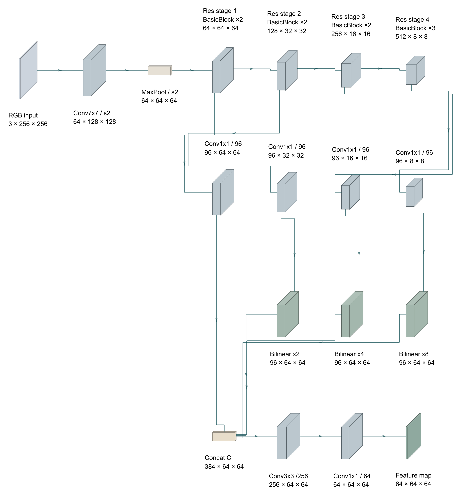

[PDF](gallery/stanet-extractor.pdf) · [SVG](gallery/stanet-extractor.svg) · [三维GLB](gallery/stanet-extractor.glb) · [离线三维](gallery/stanet-extractor.3d.html) · [结构JSON](gallery/stanet-extractor.ir.json) · [体积配置](gallery/stanet-extractor.volume.json)

依据：[原论文或作者代码](https://github.com/justchenhao/STANet/tree/6152d72f55df00a43d341580970be7a58c6b0cd5)，Pinned author code and paper doi:10.3390/rs12101662, Fig.2 and §2.1。

范围：Pinned mynet3 code uses BasicBlock depths2/2/2/3 and final dilation multipliers1/2/4. Four96-channel projections align and concatenate in order stage4,stage1,stage2,stage3.

