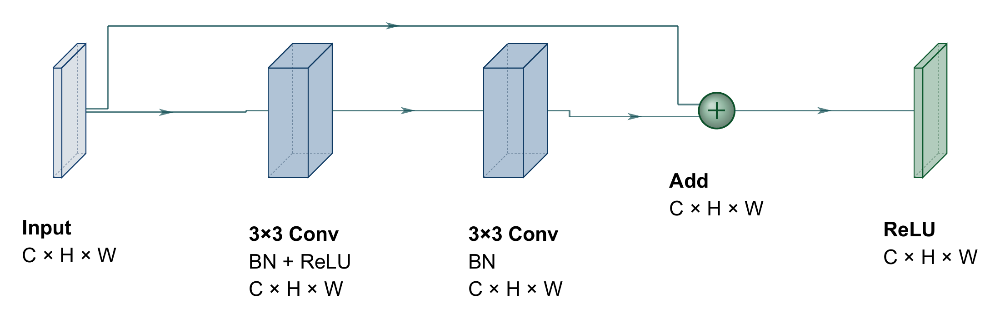
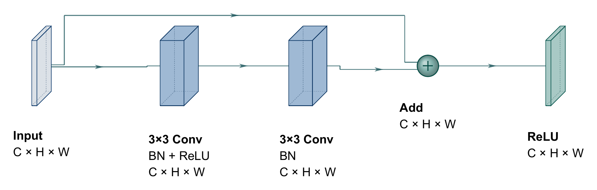
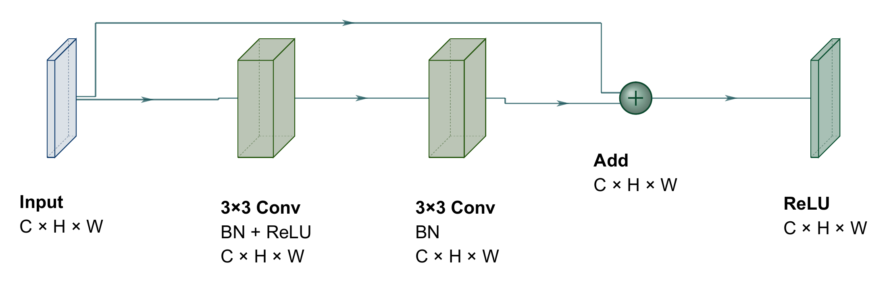
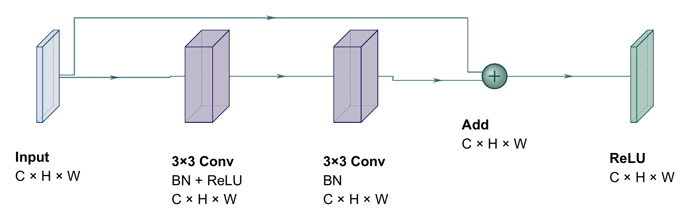
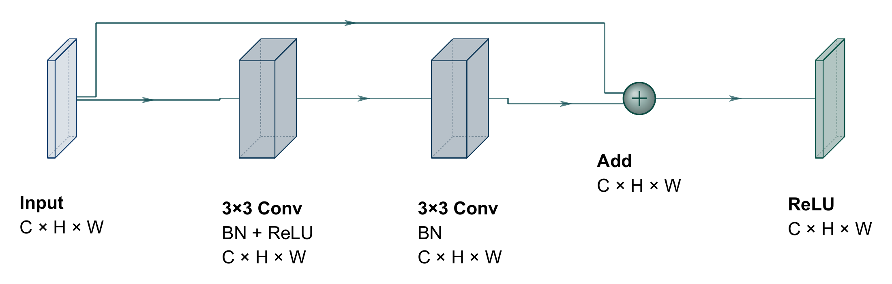

# 五套科研配色

五套主题采用相同的结构和几何，只改变语义角色配色，便于实际比较。每个主题都可通过自然语言或CLI用于新的论文和模型图。publication为steel-teal的别名。

```text
node skills/engineering-model-diagrams/scripts/compile-model.mjs MODEL.ir.json --theme sage-earth --out output/model
```

## Steel & Teal · 钢蓝青绿

theme: `steel-teal`



[PDF](palettes/steel-teal.pdf) · [SVG](palettes/steel-teal.svg) · [体积配置](palettes/steel-teal.volume.json)

## Ocean & Sand · 海蓝砂金

theme: `ocean-sand`



[PDF](palettes/ocean-sand.pdf) · [SVG](palettes/ocean-sand.svg) · [体积配置](palettes/ocean-sand.volume.json)

## Sage & Earth · 鼠尾草大地

theme: `sage-earth`



[PDF](palettes/sage-earth.pdf) · [SVG](palettes/sage-earth.svg) · [体积配置](palettes/sage-earth.volume.json)

## Plum & Slate · 灰紫岩蓝

theme: `plum-slate`



[PDF](palettes/plum-slate.pdf) · [SVG](palettes/plum-slate.svg) · [体积配置](palettes/plum-slate.volume.json)

## Graphite & Amber · 石墨琥珀

theme: `graphite-amber`



[PDF](palettes/graphite-amber.pdf) · [SVG](palettes/graphite-amber.svg) · [体积配置](palettes/graphite-amber.volume.json)

